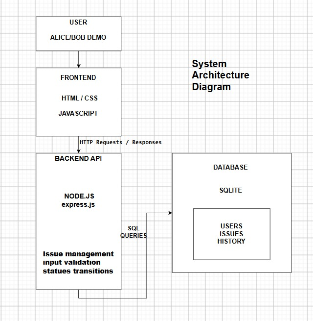
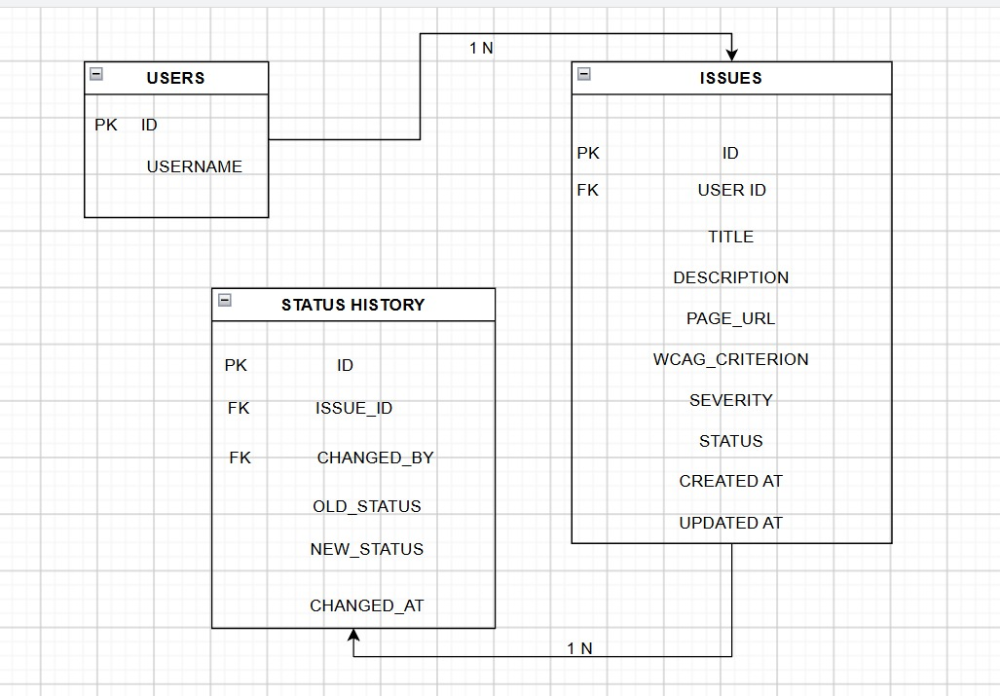

# Architecture — Accessibility Issue Tracker

## 1. Overview

The local app uses HTML, CSS, and vanilla JavaScript in the browser. The browser sends requests to a Node.js and Express API, which validates input and reads or writes data in a SQLite database using `better-sqlite3`.

This setup keeps the project small and easy to run locally, without a frontend build step. A framework such as React could help if the interface grows, while PostgreSQL would be a better fit for a production service with more users and concurrent activity.

The current application is a local demonstration. The production components discussed below are proposals, not features that are already implemented. The production design is intended to address the assignment scenario of 500 teams, about 20,000 users, and up to one million issues.

## 2. System architecture

The system architecture diagram is saved at `docs/production-architecture.png`.

The local request path is:

1. A user works in the browser interface.
2. The frontend sends HTTP requests to the Express API and receives JSON responses.
3. The API validates input, checks issue ownership, and applies the status workflow.
4. The API reads from or writes to the SQLite database.

For a production deployment, the design could add the following components:

- **Static hosting or a CDN** to serve frontend files.
- **A real authentication and session layer** to establish user identity.
- **PostgreSQL** in place of SQLite for a larger, concurrent service.
- **Object storage** for uploaded screenshots, with file metadata stored in the database.
- **A queue, worker, and email provider** for sending notifications about Critical issues.
- **A cache**, if measurements show that it would help. Cached responses must not bypass authorization.

These are future design options and are not part of the local app.

## 3. Database design

The entity relationship diagram is saved at `docs/er-diagram.png`.

The database has three tables.

### `users`

- `id` — primary key
- `username` — username for the demo account

### `issues`

- `id` — primary key
- `user_id` — foreign key to `users.id`
- `title` — issue title
- `description` — issue description
- `page_url` — URL of the page with the issue
- `wcag_criterion` — related WCAG criterion, if provided
- `severity` — `Minor`, `Moderate`, `Serious`, or `Critical`
- `status` — `Open`, `In Progress`, or `Resolved`
- `created_at` — creation time
- `updated_at` — last update time

### `status_history`

- `id` — primary key
- `issue_id` — foreign key to `issues.id`
- `changed_by` — foreign key to `users.id`
- `old_status` — previous status; empty for the initial history entry
- `new_status` — status after the change
- `changed_at` — time of the change

A user can own multiple issues. An issue can have multiple status-history entries, and each history entry records which user made the change. Creating an issue also creates an initial history entry for its `Open` status.

The local schema includes indexes for common owner-scoped queries and for reading an issue's status history in time order:

- `issues(user_id, created_at DESC)`
- `issues(user_id, status)`
- `issues(user_id, severity)`
- `status_history(issue_id, changed_at)`

## 4. Creating an issue

When a user creates an issue, the frontend sends JSON to `POST /api/issues`.

The API checks the demo user identity, validates the submitted fields, and accepts only HTTP or HTTPS page URLs. Invalid input returns `422` with validation details. The owner ID comes from the request's demo identity rather than from an owner ID supplied in the form.

On success, the issue is saved and the API returns `201 Created` with the new issue. The frontend can then refresh the list and show a confirmation. If saving fails, the interface should report the failure rather than display a success message.

The local identity header is intended for the demo only. A deployed version would need a proper authentication mechanism and server-side authorization.

## 5. Changing an issue's status

The frontend sends a request to `PATCH /api/issues/:id/status`. The API checks that the issue belongs to the current demo user and verifies that the requested transition is allowed.

The permitted transitions are:

- `Open` → `In Progress`
- `In Progress` → `Open`
- `In Progress` → `Resolved`
- `Resolved` → `Open`

For example, changing an issue directly from `Open` to `Resolved` is rejected. The history table records the status changes.

An issue that does not exist or does not belong to the current user returns `404`. Invalid input returns `422`, while a disallowed status transition returns `409`.

For a production system, the issue update and history insert should be kept in a single database transaction. Concurrency handling should also prevent a stale update from overwriting a newer change; one option is a version field or a conditional update that returns `409 Conflict` when the expected prior state no longer matches.

## 6. API endpoints

| Method | Path | Purpose |
|---|---|---|
| `GET` | `/api/me` | Return the current demo user |
| `GET` | `/api/issues` | List the current user's issues; supports status and severity filters |
| `POST` | `/api/issues` | Create an issue for the current user |
| `GET` | `/api/issues/:id` | Return an issue and its status history |
| `PUT` | `/api/issues/:id` | Update an issue's fields |
| `PATCH` | `/api/issues/:id/status` | Change an issue's status |

The demo identity is passed in the `x-demo-user` header. This is not secure authentication and must not be used as-is in a public deployment. A production system should establish identity using a proper session or token mechanism, use HTTPS, and check authorization on every request. Hiding a button in the frontend is not a substitute for backend authorization.

## 7. Growth and reliability

The current app loads all of a user's issues at once. With a much larger dataset, pagination and query plans should be reviewed, and indexes should be based on actual query patterns. A managed PostgreSQL service and connection pooling would also be worth considering for production.

If the database is unavailable, the API should return an error and the interface should not report that a write succeeded. A production deployment would also need health checks, monitoring, backups, recovery procedures, and alerts. Retrying a write without an idempotency strategy can create duplicate records, so retries need to be designed carefully.

## 8. Attachments and notifications

Screenshots and email notifications are not implemented in the local app.

If attachments are added later, an upload endpoint could store file contents in object storage and keep metadata such as the issue ID, object key, content type, file size, uploader, and timestamp in the database. Uploads and downloads would need file validation and access checks.

For Critical issues, a future notification flow could save the issue and enqueue a job. A worker would send the email separately, so the browser request would not need to wait for delivery. Retry limits, duplicate-job handling, and monitoring would be needed.

## 9. Accessibility considerations

The interface includes a skip link, form labels, visible focus styles, text labels for status and severity, and live regions for messages. These are useful measures, but they do not establish WCAG conformance. Keyboard, zoom, automated, and screen-reader checks should be performed and recorded in [ACCESSIBILITY.md](ACCESSIBILITY.md).

API validation errors should be presented in text and associated with the relevant fields. The interface should make save and status messages available to assistive technology without unexpectedly moving focus. Production error responses should not expose stack traces or sensitive implementation details.

